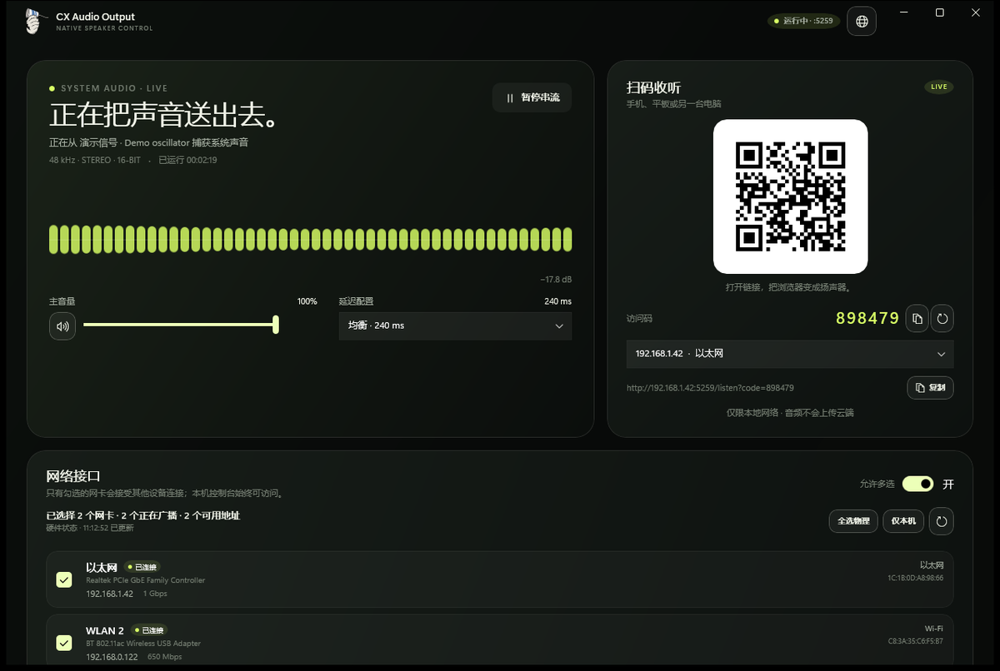
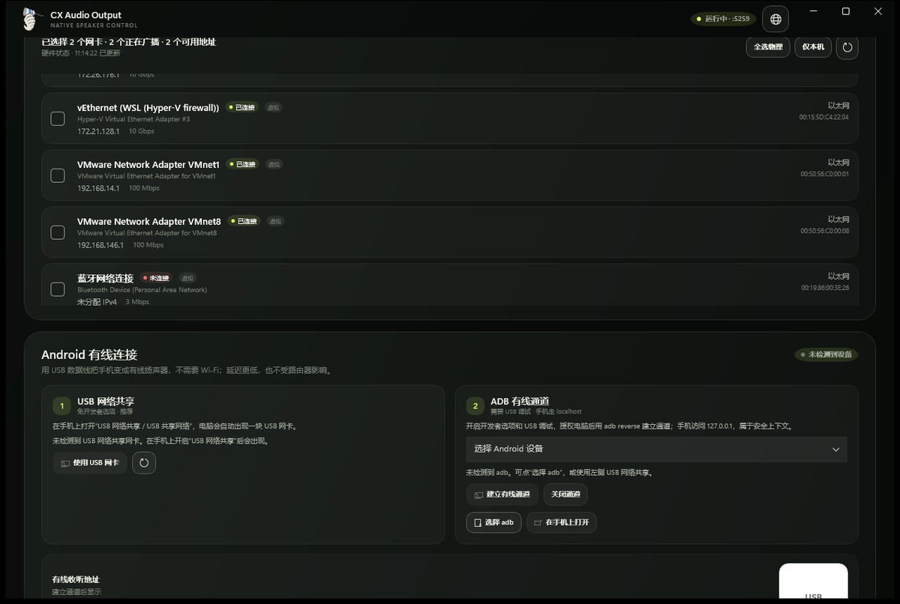
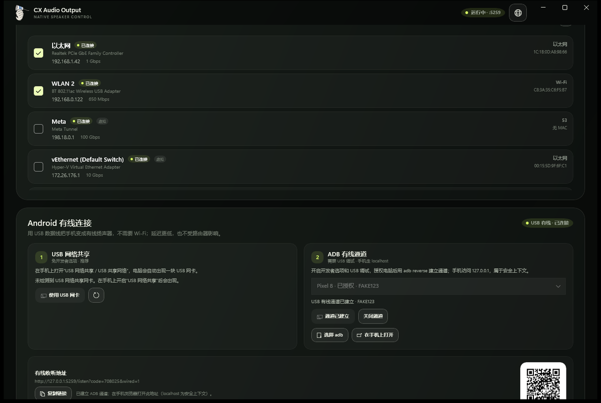
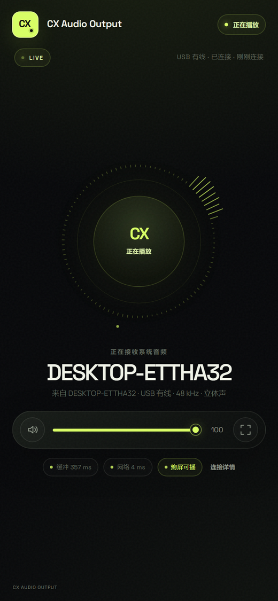

# CX Audio Output 1.3


**把手机、平板或另一台电脑变成 Windows 的无线或有线扬声器。WinUI 3 Webview2 控制台，局域网或 USB 数据线即开即用。**

**Publisher: MasterTea**  
**GitHub: [Master-Tea/CX-Audio-Output](https://github.com/Master-Tea/CX-Audio-Output)**  
**License: MIT**

CX Audio Output 在 Windows 上通过 WASAPI Loopback 捕获默认输出设备的声音，再用局域网 WebSocket 或 USB 有线通道把 PCM 音频发送给浏览器。接收端不需要安装 App，打开网页、点一下“开始聆听”即可。

## 下载与开源

- [最新 Release](https://github.com/Master-Tea/CX-Audio-Output/releases/latest)
- [源代码](https://github.com/Master-Tea/CX-Audio-Output)
- [问题反馈](https://github.com/Master-Tea/CX-Audio-Output/issues)

```bash
git clone https://github.com/Master-Tea/CX-Audio-Output.git
```

Release 提供 Windows x64 ZIP、已签名 MSIX、安装脚本和 SHA256 校验值。  
源代码使用 MIT License 开源；构建不会提交 `bin`、`obj`、`dist`、MSIX 私钥或打包中间目录。

1.3 更新：

- **Android USB 有线连接**：原生控制台新增“Android 有线连接”卡片，支持两种不需要安装 App 的方式：
  - **USB 网络共享（RNDIS）**：在手机上开启“USB 网络共享”，自动识别 USB 网卡并生成有线收听地址。
  - **ADB 有线通道**：`adb reverse` 把手机的 `127.0.0.1:端口` 映射到电脑，手机可用 localhost 安全上下文，优先启用 AudioWorklet；支持自动检测设备、一键建立/关闭通道、在手机上打开收听页。
- **后台与熄屏播放**：接收端使用媒体会话（MediaSession）、Safari AudioSession 和静默 MediaStream 保活，切换到后台、锁屏或关闭屏幕后继续播放；Android / iOS 锁屏界面会显示媒体控制。
- **屏幕常亮可选**：默认不再强制常亮，改为“后台 / 熄屏继续播放”和“保持屏幕常亮”两个开关，可在连接详情中随时切换。
- **有线状态可见**：接收设备卡片和网页连接详情会显示“USB 有线”，方便确认当前走的是数据线还是 Wi-Fi。
- **设置兼容**：网络选择与 adb 路径保存在同一份 `settings.json`，两者互不覆盖。

1.2 更新：

- **全新透明底图标**：茶爪传声筒图标，透明背景，同步用于 exe、窗口、任务栏和网页 favicon。
- **稳定性增强**：音频捕获线程使用 MMCSS + AboveNormal 优先级；兼容模式使用 4096 帧缓冲、额外安全缓冲、自适应目标、积分式时钟校正和欠载淡出；AudioWorklet 也有自适应缓冲与淡出，减少杂音、爆音和卡顿。
- **欠载可见**：WinUI 接收设备卡片会显示“稳定”或“欠载 N 次”，方便判断是否需要切换延迟配置。

此前版本已经包含：

- **WinUI 3 控制台**：不再依赖浏览器管理服务。
- **网卡选择**：可只选一块，也可多选；只允许选中的网卡接受局域网连接。
- **实时硬件状态**：网卡插拔、状态、IP、速率自动刷新；音频设备状态实时同步。
- **AudioWorklet 兼容模式**：修复“所有设备都提示不支持 AudioWorklet”的问题。



## 为什么之前所有设备都提示不支持 AudioWorklet？

不是所有浏览器都真的不支持。**AudioWorklet 只在安全上下文（HTTPS 或 localhost）中可用**。  
从另一台设备访问 `http://192.168.x.x:5240` 时，页面不是安全上下文，浏览器会把 `audioWorklet` 隐藏起来，所以旧版接收端会直接报“不支持 AudioWorklet”。

1.2 起，接收端会自动切换：

- 本机 `http://127.0.0.1` 或未来使用 HTTPS 时：优先使用 **AudioWorklet**。
- 局域网 HTTP 访问时：自动使用 **ScriptProcessorNode 兼容模式**，仍然有同样的环形缓冲、漂移校正、音量和断线恢复。
- 接收端的连接详情和播放页会显示 **兼容模式** 标签；这是正常状态，不是错误。

兼容模式在旧版 iOS Safari、旧 Android WebView、智能电视浏览器等环境下也比 AudioWorklet 更容易工作。

## 稳定性改动

1.2 针对偶发杂音、爆音和卡顿做了以下调整：

- **捕获线程**：设置 `AboveNormal` 线程优先级，并注册 Windows MMCSS `Pro Audio` 类别，减少 UI / 网页 / 网络负载对 WASAPI 包泵的调度影响。
- **兼容模式缓冲**：ScriptProcessor 缓冲从 2048 提高到 4096 帧，目标缓冲额外增加 60 ms；首次启动多预缓冲 60 ms。
- **自适应缓冲**：每次欠载自动把目标缓冲提高 35 ms（会话内最多 +180 ms），避免同一问题反复出现。
- **时钟校正**：比例 + 积分式重采样，自动学习设备实际时钟，降低长时间播放后缓冲逐渐耗尽或堆积的概率。
- **平滑处理**：欠载时对最后 96 个采样做淡出，重新缓冲突发时淡入，减少“咔哒”声。
- **缓冲上限**：超过目标 +350 ms 时主动丢弃过旧数据，避免延迟无上限增长。
- **可视化降载**：兼容模式把装饰性可视化限制在约 12 fps，优先保证音频回调。
- **接收设备健康度**：WinUI 卡片显示“稳定”或“欠载 N 次”；网页“连接详情”也能看到欠载次数。

如果网络本身抖动明显，建议仍选择“稳定”（450 ms）配置。

## 快速开始

1. 从 [发布](https://github.com/Master-Tea/CX-Audio-Output/releases/latest) 下载并解压 `CXAudioOutput-win-x64.zip`。
2. 双击 `CXAudioOutput.exe`（或 `Start CX Audio Output.cmd`）。
3. 原生控制台会自动启动服务（默认端口 `5240`）。
4. 在“网络接口”中勾选一块或多块要使用的网卡。
5. 让手机 / 平板 / 另一台电脑连接同一个 Wi-Fi 或局域网；Android 也可以改用 USB 数据线（见下文“Android 有线连接”）。
6. 扫描控制台二维码，或在接收设备上打开链接并输入访问码。
7. 在接收设备上点击 **开始聆听**。
8. 需要锁屏或切到后台继续播放时，保持页面打开即可；默认已启用“后台 / 熄屏继续播放”。

> 首次运行请在 Windows 防火墙提示中选择 **允许访问**，并勾选 **专用网络**。  
> USB 网络共享在 Windows 中可能被识别为“公用网络”，如果手机打不开链接，请同时允许 **公用网络**，或把该 USB 网卡的网络配置文件改为专用。  
> 完整发布目录需要一起保留，`wwwroot`、DLL 和资源目录都是运行所需。

## MSIX 安装包

[最新 Release](https://github.com/Master-Tea/CX-Audio-Output/releases/latest) 同时提供 **已签名的 MSIX**：

- `CXAudioOutput_1.3.0.0_x64.msix`
- `MasterTea-CXAudioOutput.cer`
- `Install-MSIX.ps1`
- `MSIX-INSTALL.txt`
- `MSIX-icon-preview.png`

安装包信息：

```text
Publisher : MasterTea
Identity  : MasterTea.CXAudioOutput
Version   : 1.3.0.0
Arch     : x64
Signature : SHA256 + DigiCert timestamp
```

签名证书是 **MasterTea 自签名代码签名证书**（`CN=MasterTea`），不是公共 CA 证书。  
第一次安装需要管理员权限，让本机信任该证书：

```powershell
certutil -addstore -f Root .\MasterTea-CXAudioOutput.cer
Add-AppxPackage .\CXAudioOutput_1.3.0.0_x64.msix
```

也可以右键 `Install-MSIX.ps1`，选择“使用 PowerShell 运行”（需要管理员）。  
如果报 `0x800B0109`，说明证书还没有导入 **本地计算机** 的受信任根，请用管理员权限重试。

> 自签名适合本机/内部测试。若要公开分发，建议换公共 CA 或 Azure Trusted Signing 后重新签名。
> MSIX 是 x64 全信任桌面包，要求 Windows 10 2004（19041）或更高版本。

## 原生控制台



### 网络接口

- 每块网卡都有独立复选框；勾选一块就是单选，勾选多块就是多选。
- “允许多选”开关关闭时，选择第二块网卡会自动取消前一块，适合严格单出口。
- “全选物理”只选已连接、有 IPv4 的物理网卡；虚拟 / VPN 网卡可以手动勾选。
- “仅本机”会清空网卡选择：只有本机能打开控制台，其他设备无法连接。
- 只有选中网卡的 IP 会生成二维码和收听链接；访问未选中的网卡会收到 `403`。
- 网卡状态每 2 秒刷新一次，同时监听 Windows 网络变化事件。插拔网卡、切换 Wi-Fi、IP 改变都会自动更新。
- 选择会保存到：
  - 正常安装：`%LOCALAPPDATA%\CXAudioOutput\settings.json`
  - 如果该目录不可写：程序目录下的 `data\settings.json`

### 硬件状态

- 显示网卡名称、类型、连接状态、IPv4、链路速率、MAC、虚拟网卡标记。
- 音频设备（默认输出）名称、状态、采样率实时同步。
- 接收设备数量、每台设备的延迟、缓冲、音量会持续刷新。
- 关闭窗口时服务停止；服务运行期间控制台可以最小化。

### 浏览器控制台

原生窗口右上角的“打开网页控制台”会打开 `http://127.0.0.1:5240/studio`。网页控制台与原生 UI 共享状态，适合在浏览器里查看二维码或做演示。

## Android 有线连接



Android 手机可以用 USB 数据线连接电脑，不经过 Wi-Fi。原生控制台的“Android 有线连接”卡片提供两种方式。

### 方式一：USB 网络共享（推荐，免开发者选项）

1. 用支持数据传输的 USB 线连接手机和电脑。
2. 在手机通知栏或“设置 → 网络和互联网 → 热点和网络共享”中打开 **USB 网络共享**（部分品牌叫“USB 共享网络”）。
3. Windows 会出现一块 USB 网卡，类型显示为“USB 网络共享”，控制台会显示“USB 网络共享 · 待启用”。
4. 点击 **使用 USB 网卡**，然后扫描右侧二维码，或在手机浏览器打开下方“有线收听地址”。
5. USB 网络共享走 HTTP，接收端会自动使用 ScriptProcessor 兼容模式，音质和缓冲逻辑与 Worklet 一致。

> 如果开启共享后没有出现网卡，请换一根支持数据传输的线，或重新插拔；部分手机需要在“开发者选项 → USB 配置”中选择“USB 网络共享”。

### 方式二：ADB 有线通道（localhost + AudioWorklet）

适合已开启开发者选项、愿意使用 adb 的用户。该方式让手机访问 `127.0.0.1`，属于安全上下文，接收端会优先使用 AudioWorklet。

准备：

- 在手机“开发者选项”中开启 **USB 调试**，插线后在手机上允许这台电脑调试。
- 电脑上有 `adb.exe`。控制台会自动在 `platform-tools`、`%LOCALAPPDATA%\Android\Sdk\platform-tools`、PATH 等常见位置查找；也可以点 **选择 adb** 手动指定。

使用：

1. 连接数据线，等待卡片显示手机型号和“已授权”。
2. 点击 **建立有线通道**。应用会执行 `adb reverse tcp:<端口> tcp:<端口>`。
3. 点击 **在手机上打开**，或扫描下方二维码；手机会打开 `http://127.0.0.1:<端口>/listen?...`。
4. 点击 **关闭通道** 或退出应用时，会自动移除 `adb reverse`。

> 端口跟随 `--port` 参数，默认 5240。ADB 通道只建立在本机与已授权手机之间，不会新增局域网监听端口。  
> 注意：`adb reverse` 会把电脑的 `127.0.0.1:<端口>` 暴露给这台手机（这也是 localhost 安全上下文和 AudioWorklet 的来源）。请只在可信手机上使用，连接结束后点“关闭通道”。

## 接收端

<p align="center">
  
</p>

- 通过二维码或访问码加入。
- 点击“开始聆听”后浏览器才允许播放声音（自动播放策略要求一次用户手势）。
- 支持音量、静音、全屏、后台播放、屏幕常亮、连接详情和断线重连。
- 延迟配置：
  - 低延迟：目标缓冲 120 ms
  - 均衡：目标缓冲 240 ms（默认，稳定性更好）
  - 稳定：目标缓冲 450 ms
- 兼容模式会显示“兼容模式”标签；音质和缓冲逻辑与 Worklet 模式一致，但由主线程处理音频，CPU 占用略高。
- 兼容模式与 AudioWorklet 都会额外增加约 60 ms 的安全缓冲，欠载后会自动再提高目标缓冲，优先保证连续播放。
- 有线连接时，播放页和“连接详情”会显示“USB 有线”；ADB 通道会优先使用 AudioWorklet。

## 后台与熄屏播放

接收端默认启用后台播放保护，目标是切到后台、锁屏或关闭屏幕后声音继续。发送端（Windows 控制台）需要保持运行；最小化窗口不影响串流。

- **媒体会话**：通过 MediaSession 向系统注册正在播放的媒体，Android 锁屏通知、Windows 媒体控制、macOS 现在播放和 iOS 锁屏界面会显示控制。
- **Safari AudioSession**：Safari 17+ 上声明 `playback` 类型，减少锁屏后被系统的音频会话中断。
- **静默 MediaStream 保活**：用一个极低音量（约 -80 dB，实际不可闻）的 Web Audio 振荡器接到 `<audio>` 元素的 MediaStream，既不发声，又让浏览器把页面当作正在播放媒体，避免后台节流或音频上下文被挂起。
- **锁屏播放/暂停**：锁屏控制里的播放/暂停会映射到接收端的本地暂停/恢复（实际串流仍在继续，只是静音/取消静音）。
- **屏幕常亮**：默认关闭；在“连接详情”中打开“保持屏幕常亮”后申请 Wake Lock。关闭它才能让手机真正熄屏。

平台差异：

- **Windows / macOS / Linux 桌面浏览器**：切换标签页、最小化窗口或关闭显示器都不影响播放；请保持浏览器页面打开。
- **Android**：Chrome 在锁屏后通常可以继续播放；部分厂商的省电策略会限制后台，建议把浏览器加入“不受限制”，或保留媒体通知。
- **iOS / iPadOS**：Safari 的锁屏播放依赖系统音频会话；如果锁屏后停止，请重新打开页面，确认“后台 / 熄屏继续播放”为开启状态。iOS 的静音开关会影响 Web Audio 输出。
- **兼容模式**：USB 网络共享或局域网 HTTP 使用 ScriptProcessor，后台稳定性略低于 AudioWorklet；ADB 通道或 localhost 会优先使用 AudioWorklet。

如果不需要后台播放，可在“连接详情”中关闭“后台 / 熄屏继续播放”，页面会释放静默媒体流和媒体会话，适合临时省电。

## 工作原理

```text
┌──────────────────── Windows PC ─────────────────────────────────────┐
│                                                                    │
│  WinUI 3 原生控制台                                                │
│   ├─ 网卡单选/多选 ──→ NetworkSelectionService                     │
│   ├─ 实时硬件状态（2 s 轮询 + NetworkChange 事件）                  │
│   ├─ 音量/延迟/暂停/设备管理                                       │
│   └─ QR 码、访问码、日志、设置目录                                 │
│                                                                    │
│  Windows 默认输出设备                                              │
│        │ WASAPI Loopback                                            │
│        ▼                                                           │
│  Kestrel + WebSocket（localhost 控制台 + 局域网音频）              │
│        │ 只接受选中网卡 IP 的远程连接；本机 loopback 始终允许       │
│        ▼                                                           │
└────────┼───────────────────────────────────────────────────────────┘
         │
         ├─ Wi-Fi / 局域网：ws://<选中网卡 IP>:5240/ws/audio
         └─ Android USB：USB 网络共享网卡，或 adb reverse 后的 127.0.0.1
          │  20 ms Int16 PCM 帧
          ▼
┌──────────────────────── 浏览器接收端 ──────────────────────────────┐
│  WebSocket → 抖动缓冲                                            │
│    ├─ 安全上下文 / localhost：AudioWorklet                       │
│    └─ 局域网 HTTP：ScriptProcessorNode 兼容模式                  │
│         → 漂移校正 → GainNode → 扬声器                            │
│  媒体会话 + 静默 MediaStream → 后台 / 熄屏继续播放                │
└────────────────────────────────────────────────────────────────────┘
```

- 服务端不依赖第三方音频库，直接调用 Windows Core Audio COM 接口。
- 支持 Float32/64、PCM 8/16/24/32，多声道下混为立体声，输出 16-bit PCM。
- 没有声音播放时会补静音帧，保持接收端缓冲就绪。
- 默认输出设备变化时会自动重启捕获。
- 每个接收端约 1.5 Mbps 下行带宽（48 kHz × 16-bit × 立体声）。

## 系统要求

**发送端**

- Windows 10 1809 或更高版本（Windows 11 均可）。
- x64 系统。
- 默认音频输出设备。
- 发布包是 self-contained 的，不需要安装 .NET。
- Android ADB 有线为可选功能，需要 Android platform-tools 中的 `adb.exe`（USB 网络共享不需要）。

**接收端**

- 支持 Web Audio 的现代浏览器。
- 推荐 Chrome / Edge / Safari / Firefox 的较新版本。
- 与电脑在同一局域网，且未被 AP 隔离；或使用 Android USB 有线连接。
- Android 有线需要一根支持数据传输的 USB 线；ADB 方式还需要 platform-tools 中的 `adb.exe` 和已授权的 USB 调试。
- 兼容模式可在局域网 HTTP 下工作；AudioWorklet 模式只在 HTTPS 或 localhost 下启用。
- 后台 / 熄屏播放依赖浏览器的媒体会话支持；iOS 需要 Safari 17+ 的 AudioSession 行为更佳。

## 防火墙

服务监听 TCP `5240`。如果其他设备打不开链接：

1. 在 Windows 防火墙提示中允许 `CXAudioOutput.exe` 访问 **专用网络**；USB 网络共享场景可能还需要 **公用网络**。
2. 或以管理员身份运行：

```powershell
New-NetFirewallRule -DisplayName "CX Audio Output" -Direction Inbound -Protocol TCP -LocalPort 5240 -Action Allow -Profile Private,Public
```

如果只想在专用网络使用，也可以把 USB 网卡的网络配置文件改为专用：

```powershell
Get-NetConnectionProfile
Set-NetConnectionProfile -InterfaceAlias "<USB 网卡名称>" -NetworkCategory Private
```

仓库中也提供了：

```powershell
.\scripts\add-firewall-rule.ps1 -Port 5240
```

## 命令行

```text
CXAudioOutput.exe [--port 5240] [--demo]
```

| 参数 | 说明 |
| --- | --- |
| `--port <端口>` / `--port=<端口>` | 指定 HTTP/WebSocket 端口，默认 5240。 |
| `--demo` | 不捕获系统音频，发送内置测试信号，用于验证网络和接收端。 |
| `--no-browser` | 兼容旧参数；原生 UI 不会自动打开浏览器，此参数可忽略。 |

## 从源码构建

需要 **.NET 8 SDK**。WinUI 依赖 Windows App SDK，NuGet 会在首次构建时自动还原。

```powershell
dotnet publish .\src\CXAudioOutput\CXAudioOutput.csproj `
  -c Release -r win-x64 --self-contained true `
  -p:DebugType=None -p:DebugSymbols=false `
  -o .\dist\CXAudioOutput-win-x64
```

或者：

```powershell
.\scripts\build.ps1
```

发布目录约 200 MB（包含 .NET 运行时和 Windows App SDK 运行时），压缩后约 80–100 MB。

### 打包 MSIX

MSIX 使用 `winapp`（Windows App SDK CLI）和 Python + Pillow 生成图标、打包并签名：

```powershell
.\scripts\build-msix.ps1 -PythonPath C:\Python311\python.exe
```

脚本会：

1. 调用 `build.ps1` 生成 self-contained 发布目录。
2. 运行 `scripts\make-msix-assets.py`，从 `design/icon-source.png` 生成：
   - `Square44x44Logo` 的 16/20/24/30/32/36/40/48/60/64/72/80/96/256 目标尺寸；
   - 100/125/150/200/400 缩放变体；
   - 透明安全区留白，保持 1:1 比例，不拉伸、不裁切。
3. 复制 `packaging/msix/AppxManifest.xml` 和 `Assets`，调用 `winapp package`。
4. 使用 `packaging/msix/signing/MasterTea-CXAudioOutput.pfx` 签名，并添加 DigiCert RFC3161 时间戳。
5. 用 `signtool verify /pa` 校验。

输出：`dist\CXAudioOutput_1.3.0.0_x64.msix`。  
图标预览：`packaging\msix\icon-preview-msix.png`。

## 故障排查

### 接收端仍显示“不支持 AudioWorklet”

1.2 起已加入兼容模式，正常不再出现这个错误。如果仍然出现：

- 确认接收端加载的是 1.3 的页面。旧标签页可能缓存了旧 JS；关闭页面重新扫码，或强制刷新。
- 打开接收端的“连接详情”，确认“音频引擎”显示为 `兼容模式 · ScriptProcessor`。
- 若显示 `AudioWorklet`，说明当前是安全上下文，优先使用了 Worklet。
- 若两种引擎都不可用，请更新浏览器；极老的浏览器可能既没有 AudioWorklet 也没有 ScriptProcessor。

### 其他设备访问返回 403

这是网卡选择在起作用：

- 在原生控制台勾选接收设备实际连接的那块网卡。
- 检查网卡是否有 IPv4 地址。
- 如果只想使用 Wi-Fi，只勾选 Wi-Fi 网卡即可。

### 网络接口列表为空

- 点击“刷新”或等待 2 秒。
- 检查 Windows 网络适配器是否启用。
- 虚拟网卡可能排在列表后面，需要滚动。

### 没有声音

- 确认电脑默认输出设备正在播放；应用捕获的是默认输出设备。
- 接收端必须点过“开始聆听”。
- 检查接收设备音量、静音和 iOS 静音开关。
- 某些 DRM/受保护音频不会被回环捕获。
- 若控制台显示 `no-device`，连接一个输出设备，应用会自动重试。

### 声音断续

- 把延迟配置切到“稳定”（450 ms）。
- 优先 5 GHz Wi-Fi 或有线网络。
- 减少同时连接的设备数量。
- 兼容模式在主线程处理音频，低性能设备上适当提高目标缓冲。

### Android 有线连接打不开

- **USB 网络共享**：确认手机已开启“USB 网络共享”，控制台出现“USB 网络共享”网卡并点击“使用 USB 网卡”；换一根支持数据传输的线。Windows 可能把 USB 网卡识别为“公用网络”，请在防火墙中允许公用网络，或把该网卡改为专用网络。
- **ADB 通道**：确认手机已允许 USB 调试，卡片显示“已授权”；点“建立有线通道”后，再打开下方的 `127.0.0.1` 地址。
- 如果 adb 显示“未检测到”，点“选择 adb”选择 `platform-tools\adb.exe`，或把 `platform-tools` 放到程序目录下。
- 如果手机浏览器提示“无法连接”，先确认“关闭通道”未被误点，再重新建立一次。

### 锁屏 / 切后台后停止播放

- 打开接收端“连接详情”，确认“后台播放”显示“已启用”。
- 关闭“屏幕常亮”才能让手机真正熄屏；两者不冲突。
- Android 厂商省电策略可能限制后台，尝试把浏览器设为“不受限制”，并保留媒体通知。
- iOS Safari 在锁屏后停止时，重新打开页面并保持“后台 / 熄屏继续播放”开启；iOS 静音开关也会影响声音。
- 如果当前是 ScriptProcessor 兼容模式，可改用 ADB 有线通道（localhost）或 HTTPS 以获得 AudioWorklet，后台更稳定。

### 电脑本机也在响

应用只复制声音，不会关闭本机扬声器。若只想让其他设备响，请调低 Windows 音量，或把默认输出切换到一个未使用的设备。

### Windows SmartScreen

发布包没有代码签名。SmartScreen 提示时选择“更多信息 → 仍要运行”。分发时建议使用自己的代码签名证书。

## 安全与隐私

- 无云端、无账号、音频不落盘。
- 控制台和 `/ws/host` 仅允许 loopback。
- 局域网访问受选中网卡限制：未选中网卡的连接直接 `403`。
- Android ADB 通道只对已授权并选中的设备执行 `adb reverse`，不会新增局域网监听端口；USB 网络共享网卡同样需要被选中才会接受连接。
- 但 `adb reverse` 会让该手机访问电脑的 `127.0.0.1:<端口>`，包括本机控制台。请只在可信手机上开启，用完及时关闭通道。
- WebSocket 校验 Origin，防止其他网站通过浏览器操控本机服务。
- 6 位访问码，固定时间比较，按 IP 限流。
- 仅适用于可信局域网；使用 HTTP，不适用于公共 Wi-Fi。

## 已知限制

- 不是声卡驱动，不会出现在 Windows 声音输出列表。
- 只捕获默认输出设备；不支持多设备同时捕获或进程级捕获。
- ScriptProcessor 兼容模式在主线程运行，低端设备上 CPU 占用和延迟略高于 AudioWorklet。
- 不做音视频同步校正；接收端可能比视频画面晚约 200–400 ms。
- 未内置 HTTPS。局域网 HTTP 下使用兼容模式；如果一定要在局域网使用 AudioWorklet，可自行在前面加 HTTPS 反向代理并导入受信任证书。
- Android 有线连接依赖手机支持 USB 网络共享，或已开启 USB 调试并安装 adb；并不是所有数据线都支持数据传输。
- 后台 / 熄屏播放受浏览器和系统省电策略影响；部分 Android 厂商仍可能限制后台，iOS Safari 在锁屏后的行为也随系统版本变化。
- 静默 MediaStream 保活会保留一个极小的音频轨道，耗电略高于前台播放；不需要时可在“连接详情”中关闭。

## 项目结构

```text
src/CXAudioOutput/
├─ App.xaml / App.xaml.cs          # WinUI 3 应用入口
├─ MainWindow.xaml / .xaml.cs      # 原生控制台
├─ ViewModels/                     # 网卡、接收设备绑定模型
├─ AppServer.cs                    # 进程内 Kestrel + WebSocket 服务
├─ NetworkCatalog.cs               # 网卡枚举、状态、速率、IP、USB 网络共享识别
├─ NetworkSelectionService.cs      # 单选/多选、访问控制、设置持久化
├─ AndroidWiredService.cs          # Android USB 网卡、adb reverse、打开手机浏览器
├─ HardwareMonitorService.cs       # 2 秒轮询 + NetworkChange 事件
├─ AudioCaptureService.cs          # WASAPI 捕获生命周期、Demo 信号
├─ WasapiLoopbackSession.cs        # 回环捕获、格式转换、静音填充
├─ AudioHub.cs                     # 接收端/Host 会话与状态广播
├─ Endpoints.cs                    # HTTP/WS、访问码、Origin 校验
├─ wwwroot/                        # 网页控制台与接收端
└─ Assets/                         # 图标
```

## 第三方组件

- [.NET 8 / ASP.NET Core](https://github.com/dotnet/aspnetcore) — MIT
- [Windows App SDK / WinUI 3](https://github.com/microsoft/WindowsAppSDK) — MIT
- [QRCoder](https://github.com/Shane32/QRCoder) — MIT
- [qrcode-generator](https://github.com/kazuhikoarase/qrcode-generator) — MIT
- [Space Grotesk](https://fonts.google.com/specimen/Space+Grotesk) — SIL OFL 1.1
- [Manrope](https://fonts.google.com/specimen/Manrope) — SIL OFL 1.1

相关许可证位于 `THIRD-PARTY-NOTICES.md` 和 `src/CXAudioOutput/wwwroot/assets/`。

## License

MIT © 2026 MasterTea
